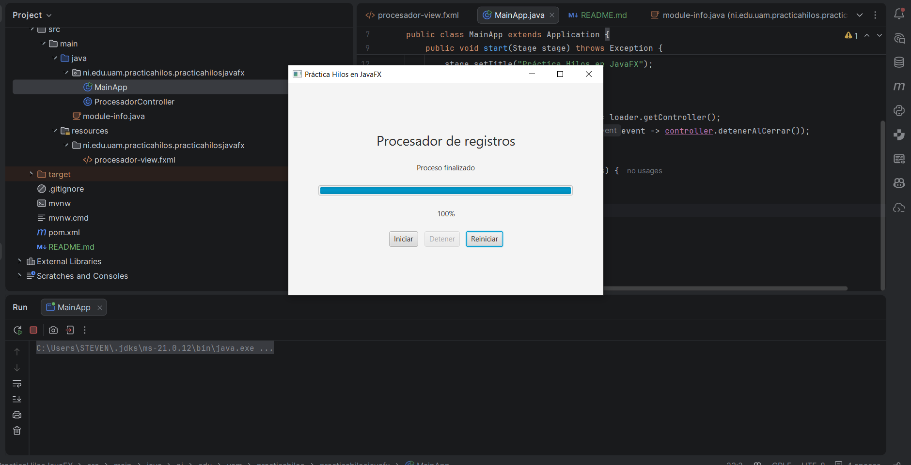
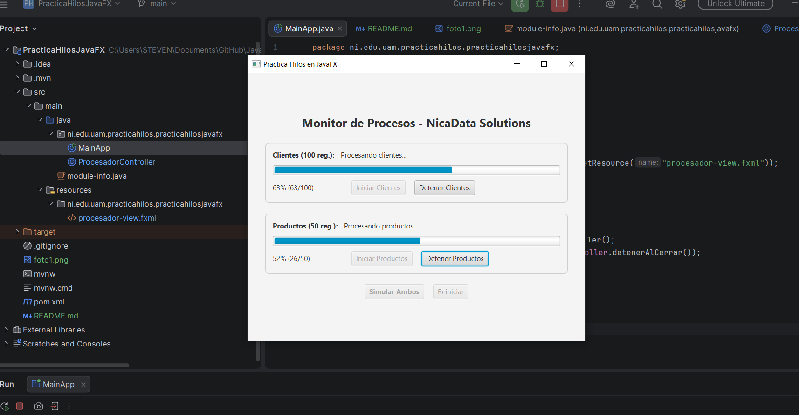

# Práctica Guiada: Hilos en JavaFX - NicaData Solutions S.A.

## Descripción
Aplicación desarrollada en **JavaFX** que implementa programación concurrente mediante `Thread` y `Runnable` para procesar registros en segundo plano sin congelar la interfaz gráfica (`JavaFX Application Thread`).

## Explicación de los hilos implementados
* **Creación con `Thread` y `Runnable`:** Se definieron tareas independientes mediante expresiones lambda (`Runnable`) ejecutadas dentro de objetos `Thread` configurados con `setDaemon(true)` para que finalicen si se cierra la ventana.
* **`Hilo-Clientes`:** Simula el procesamiento de **100 registros** con una pausa de `80 ms` por iteración (`Thread.sleep(80)`).
* **`Hilo-Productos`:** Simula el procesamiento de **50 registros** con una pausa de `150 ms` por iteración (`Thread.sleep(150)`).
* **Actualización segura (`Platform.runLater`):** Como JavaFX no permite modificar componentes visuales desde hilos secundarios, el avance de cada `ProgressBar` y `Label` se envía al hilo gráfico mediante `Platform.runLater()`.
* **Detención controlada:** Cada hilo comprueba su estado de interrupción y captura `InterruptedException` al invocar `interrupt()`, permitiendo detener cada proceso individualmente o al cerrar la aplicación (`setOnCloseRequest`).

## Capturas del funcionamiento (Práctica Guiada - 1 Hilo)

## Evidencia del Reto Final (Procesos Concurrentes - 2 Hilos)

